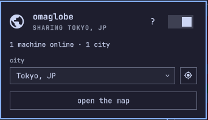
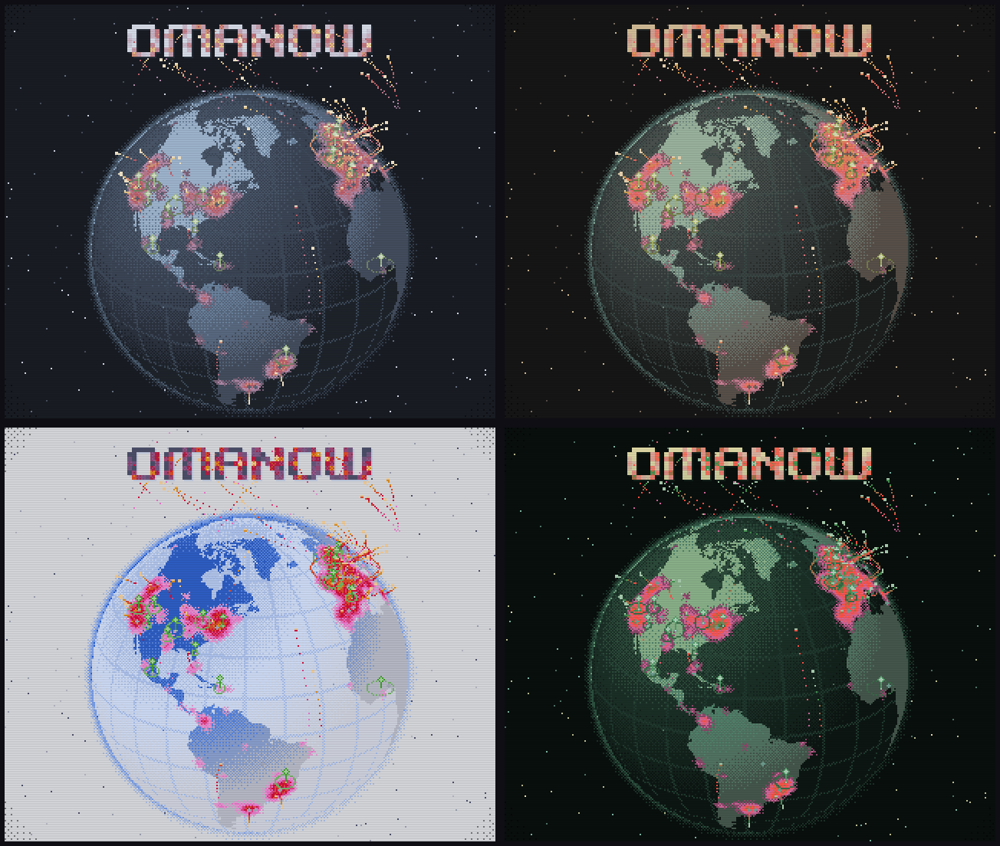

<h1 align="center">omaglobe</h1>

<p align="center">
  
</p>

<p align="center">A live pixel globe of the omarchy machines that are online right now, by city.</p>

<p align="center">
  <a href="https://omaglobe.mark-omarov.workers.dev"><b>Open the map</b></a> ·
  <a href="#install-the-plugin">Install the plugin</a> ·
  <a href="#what-it-sends">What it sends</a>
</p>

## Install the plugin

```sh
omarchy plugin add https://github.com/mark-omarov/omaglobe-plugin --enable
omarchy bar move io.github.mark-omarov.omaglobe --after omarchy.indicators
```

Hover the middle of your bar, click the globe, and switch sharing on. Your machine counts toward your city while it's online.

<p align="center">
  
</p>

## What's on the map

- A city glows brighter the more machines are online in it. It appears once three machines are there.
- Green pins mark every omarchy meetup on [omarchy.org/meetups](https://omarchy.org/meetups), past and upcoming. Click one for the date, place, and link.
- Right-click the globe in your bar to open the map in your current omarchy theme. The open page follows you when you switch themes.

<p align="center">
  
</p>

## What it sends

Sharing is off until you switch it on, and opening the website sends nothing. While sharing is on, the plugin sends the city you picked and a random install id once an hour. The server keeps a hash of the id and deletes it an hour after the last check-in, or as soon as you switch sharing off.

- omaglobe stores no names, accounts, IP addresses, coordinates, cookies, or analytics.
- The map updates once a minute, so a new dot doesn't show when someone joined.
- The locate button finds the nearest city from your weather setting or your timezone, on your machine.

## Contribute

Open an [issue](https://github.com/mark-omarov/omaglobe/issues) for ideas and bugs. To run omaglobe locally, read [CONTRIBUTING.md](CONTRIBUTING.md).

omaglobe is a community project and isn't affiliated with omarchy, omacom, or 37signals. MIT license.
